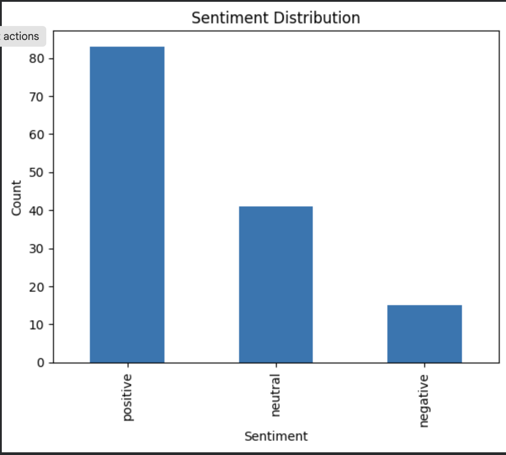
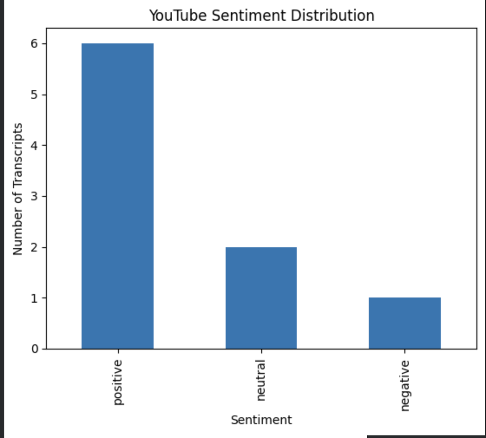
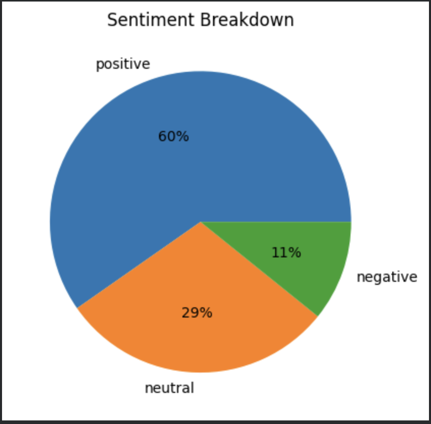
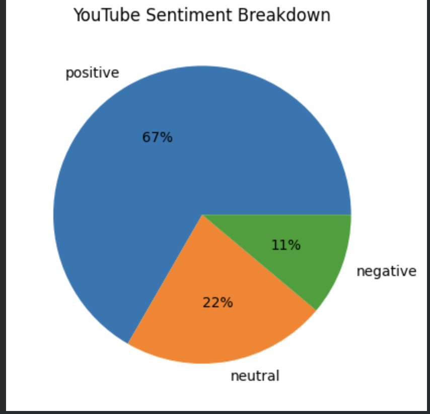
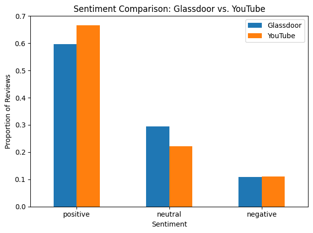

# Amazon Fulfillment Center — Employee Voice Analysis

Text analysis of Amazon fulfillment associate feedback from two public sources — Glassdoor reviews and YouTube "day in the life" videos — to surface the themes and sentiment behind employee retention, then segment the workforce to see where friction is concentrated, which group to prioritize first, and where that group's experience breaks down.

## Why this project

Companies collect far more employee feedback than anyone has time to read. This project treats Glassdoor and YouTube as two different lenses on the same workforce — one written and retrospective, one spoken and in-the-moment — and uses NLP to turn hundreds of individual reviews into patterns a decision-maker could act on, and to see where the two sources agree or disagree.

An average hides as much as it reveals, so the final stage splits the Glassdoor reviews into workforce segments (by employment status and role), compares how friction shows up in each, ranks the segments by business need, and maps the top segment's friction from experience to business impact.

## Data

| Source | Volume | Notes |
|---|---|---|
| Glassdoor | 139 reviews with usable text | Amazon Fulfillment Center reviews (Glassdoor.ca), collected manually |
| YouTube | 10 videos → 9 with usable transcripts | First-person "day in the life" / warehouse-shift videos |
| Combined | 148 rows (139 Glassdoor + 9 YouTube) | Both scored datasets stacked into one file, tagged by a `platform` column; carries a `Theme` column from the theme-tagging step |
| Segmented | 139 Glassdoor rows | Adds a `Segment` column built from `employee_status` and `employee_job_title`. YouTube rows are excluded because they have no job status or title |

Raw, cleaned, sentiment-scored, themed, segmented, and combined data files are excluded from this repo (see `.gitignore`) since they're scraped third-party content, not original data. The code here is fully documented and reproducible against your own export of the same sources.

## Pipeline

| Notebook | What it does |
|---|---|
| `01_glassdoor_data_cleaning.ipynb` | Loads raw Glassdoor export, audits missing values, drops 6 empty/constant columns (28 → 22) |
| `02_text_cleaning.ipynb` | Builds a reusable `clean_text()` function (lowercase → strip punctuation → remove NLTK stopwords) and applies it to 4 Glassdoor review fields and the YouTube transcript field |
| `03_keyword_analysis.ipynb` | Tokenizes cleaned text, counts word/bigram frequency, and visualizes results (bar charts + word clouds) per platform |
| `04_sentiment_analysis.ipynb` | Scores polarity and subjectivity with TextBlob and labels each Glassdoor review and YouTube transcript positive/neutral/negative, with bar and pie charts per platform |
| `05_sentiment_comparison.ipynb` | Loads the two scored datasets, normalizes the sentiment split for each, and compares Glassdoor and YouTube side by side |
| `06_combine_datasets.ipynb` | Standardizes the cleaned-text column name across both scored datasets, adds a `platform` column (Glassdoor / YouTube), and stacks them with `pd.concat()` into a single 148-row `combined_sentiment_data.csv` for side-by-side comparison |
| `Project5_Segment_Analysis.ipynb` | Assigns each Glassdoor review to one of 5 workforce segments, joins the segment labels to the theme tags on `review_id`, builds the Theme Frequency by Segment tables, supports the priority scoring, and builds the friction table for the top segment (evidence counts plus verified review quotes) |

## Findings

### Keyword analysis

**Glassdoor** — compensation and benefits dominate the positive language. Top bigrams: `good pay`, `good benefits`, `place work`.

**YouTube** — a schedule/fatigue theme not visible in the written reviews: `shift`, `night`, `hours`, `tired`, `sleep` cluster together, alongside `enjoy` and `worth`, suggesting the job is physically demanding but not universally disliked. Sample size is small (9 transcripts), so this is read as a theme worth investigating further, not a confirmed pattern.

### Sentiment analysis

Each document was scored with TextBlob (polarity from -1 to +1, subjectivity from 0 to 1) and labeled **positive** (polarity > 0.1), **negative** (< -0.1), or **neutral** (in between).

| Source | Positive | Neutral | Negative |
|---|---|---|---|
| Glassdoor (n = 139) | 83 (60%) | 41 (29%) | 15 (11%) |
| YouTube (n = 9) | 6 (67%) | 2 (22%) | 1 (11%) |

> With only 9 YouTube transcripts, each video moves the split by about 11 percentage points, so counts matter more than percentages there.

| Glassdoor | YouTube |
|---|---|
|  |  |
|  |  |

### Glassdoor vs. YouTube

| Sentiment | Glassdoor | YouTube | Gap (YouTube − Glassdoor) |
|---|---|---|---|
| Positive | 59.7% | 66.7% | +7.0 pts |
| Neutral | 29.5% | 22.2% | −7.3 pts |
| Negative | 10.8% | 11.1% | +0.3 pts |

Negative sentiment is almost identical on both platforms (about 11%). The only visible difference is a modest shift from neutral to positive on YouTube, and with 9 transcripts that shift equals about one video.

**Key takeaways**

1. **Glassdoor leans clearly positive.** 60% of reviews scored positive and only 11% negative. Combined with the keyword results (`good pay`, `good benefits`), the positive tone appears to be tied mostly to compensation and benefits.
2. **YouTube is also mostly positive.** 6 of 9 transcripts scored positive, 2 neutral, and 1 negative, even though the same videos are full of fatigue language (`tired`, `sleep`, `night`).
3. **The two platforms look broadly aligned.** The overall split is similar (60/29/11 vs. 67/22/11), and negative sentiment is nearly identical (10.8% vs. 11.1%). YouTube is about 7 points more positive and 7 points less neutral, but with 9 transcripts that gap is within what one or two videos would change, so this analysis doesn't show a real difference in tone between the platforms.
4. **Sentiment scores can hide the retention risk.** The fatigue and schedule themes in the YouTube keywords don't pull the transcripts' sentiment negative, which suggests that a positive score doesn't mean the strain is absent. Associates can describe a demanding job in a positive or neutral tone, so retention analysis should look at specific themes as well as overall sentiment.

### Workforce segmentation

Overall sentiment is one number for everyone, which is why the analysis moves to segments. Each of the 139 Glassdoor reviews is assigned to exactly one of five segments using `employee_status` and `employee_job_title`. The rules run in order and the first match wins, so no review falls in two groups:

1. Status is contract, intern, or freelance → **Contract, Intern & Freelance**
2. Job title is a manager or corporate/specialist role (manager, engineer, HR, program, software, maintenance) → **Managers & Corporate Roles**
3. Status is part-time, or the title says seasonal → **Part-Time & Seasonal Associates**
4. Status is regular → **Full-Time Associates**
5. Anything else (status blank) → **Associates (Status Not Reported)**

| Segment | Reviews | % of reviews |
|---|---|---|
| Full-Time Associates | 77 | 55% |
| Part-Time & Seasonal Associates | 25 | 18% |
| Associates (Status Not Reported) | 15 | 11% |
| Managers & Corporate Roles | 12 | 9% |
| Contract, Intern & Freelance | 10 | 7% |

### Theme frequency by segment

Reviews carry up to three theme tags: **Shift Strain (Night vs Day)**, **Burnout & Fatigue**, and **New-Hire Training & Support**. A review with two tags is counted once under each, so the theme columns do not add up to the "any theme" column. Only 43 of the 139 Glassdoor reviews have a theme tag.

| Segment | Shift Strain | Burnout & Fatigue | New-Hire Training | Any theme | Total reviews |
|---|---|---|---|---|---|
| Full-Time Associates | 16 | 12 | 4 | 26 | 77 |
| Part-Time & Seasonal Associates | 3 | 1 | 2 | 6 | 25 |
| Associates (Status Not Reported) | 5 | 2 | 2 | 6 | 15 |
| Managers & Corporate Roles | 2 | 1 | 1 | 3 | 12 |
| Contract, Intern & Freelance | 2 | 0 | 0 | 2 | 10 |
| **All segments** | **28** | **16** | **9** | **43** | **139** |

As a share of each segment's reviews, shift strain is the most common theme everywhere (20% overall) and burnout is concentrated in Full-Time Associates (16%, versus 0–13% elsewhere).

### Priority ranking

Each segment was scored 1–5 on Impact (how critical and hard to replace), Severity (how painful the friction is), and Size (share of reviews), then multiplied: **Priority Score = Impact × Severity × Size**.

| Rank | Segment | Impact | Severity | Size | Priority Score | Avg rating | % rated 1–2 |
|---|---|---|---|---|---|---|---|
| 1 | Full-Time Associates | 5 | 3 | 5 | 75 | 3.39 | 17% |
| 2 | Managers & Corporate Roles | 4 | 5 | 2 | 40 | 2.83 | 42% |
| 3 | Associates (Status Not Reported) | 3 | 4 | 2 | 24 | 3.07 | 20% |
| 4 | Part-Time & Seasonal Associates | 3 | 2 | 3 | 18 | 3.96 | 4% |
| 5 | Contract, Intern & Freelance | 2 | 2 | 1 | 4 | 4.00 | 20% |

Size comes directly from the review counts. Severity is judged from average rating, share of 1–2 star reviews, theme share, and negative sentiment. Impact is a judgment call and is the least data-driven score.

**Segment takeaways**

1. **Full-Time Associates are the top priority.** They are over half of all reviews and the core workforce, and they account for the most shift-strain (16) and burnout (12) mentions.
2. **Managers show the sharpest dissatisfaction** (lowest average rating, 42% rating 1–2 stars) but rest on only 12 reviews, so they rank second rather than first.
3. **Part-time and contract groups look comparatively healthy** by rating, so they are lower priority, though shift strain still appears in both.
4. **The friction table (below) traces where the top segment's strain originates**: scheduling and overtime, physical strain, and rate pressure.

### Friction table: Full-Time Associates

For the top-priority segment, each row follows one chain from what associates experience, to where it breaks down, to the likely business impact. Evidence counts come from the data, and each quote is checked in code against the real review text.

| Experience | Friction point | Likely impact | Evidence |
|---|---|---|---|
| 10–12 hour shifts, with overtime and night hours that can be mandatory | Long shifts and extra hours arrive with little notice, and breaks are limited | Fatigue and trouble planning life outside work, likely lowering morale and raising turnover | 16 reviews tagged Shift Strain; *"mandatory overtime with little to no heads up"* |
| Physically demanding, repetitive work, often standing the whole shift | Little recovery time inside the shift, so strain builds up | Burnout, injury risk, and absence, likely leading to attrition and slower output late in the shift | 12 reviews tagged Burnout & Fatigue; *"its a physical job so prepare to be tired."* |
| Tracked on rate and targets throughout the shift | Missing rate brings write-ups, and associates feel valued only for their numbers | Pressure to cut corners and quit, likely raising safety risk, turnover, and rehiring cost | 12 reviews mention rate, targets, or numbers (keyword search); *"get write ups for not meeting their rate expectations"* |

The third pain point, rate pressure, is not one of the three theme tags. It was found with a keyword search on the review text, so it includes a few loose matches. The "likely impact" column is an inference: reviews describe the friction, not the business outcome.

## Limitations

- **TextBlob is lexicon-based.** It scores words, not context, so sarcasm, mixed feelings, and negation are handled poorly. Results are best read as a rough emotional read, not an exact measure.
- **Pros and cons are blended.** A review with strong pros and strong cons averages to near-neutral, which can hide polarized opinions.
- **Text length differs a lot between sources.** TextBlob averages across the whole text, so a long transcript and a short review aren't scored on equal footing. Any Glassdoor vs. YouTube comparison should be read with that in mind.
- **Small YouTube sample.** With 9 transcripts, YouTube findings are directional only.
- **Collected, not random, samples.** Both sources are self-selected (people who chose to post), so they don't represent all associates.
- **Theme tags cover a minority of reviews.** Only 43 of 139 Glassdoor reviews carry a theme, and the tag set has three themes, so untagged complaints (pay, management, physical strain) aren't counted in the theme tables.
- **Some segments are small.** Three segments have only 10–15 reviews, so their percentages move a lot with a single review and are directional only.
- **Segment rules are keyword-based.** Job titles are free text in several languages, so a few roles may land in the wrong group, and reviews with a blank status can't be placed as full-time or part-time.
- **Impact scores are judgment, not data.** Different reasonable weights could change the ranking of the middle segments.
- **Theme tags look loose in places.** Some reviews tagged Shift Strain don't discuss shifts in their cons text, which suggests tags were applied to the full review, including the pros. Friction-table quotes were hand-picked from reviews that actually describe the problem.
- **Friction-table impacts are inferences.** Reviews describe the experience and the friction, not measured outcomes like turnover or output, so the impact column is hypothesis, not evidence.

## Tech stack

Python · pandas · NLTK · TextBlob · Matplotlib · WordCloud · Google Colab

## Status

- [x] Data collection & structuring
- [x] Text cleaning
- [x] Keyword frequency analysis
- [x] Sentiment scoring (TextBlob)
- [x] Cross-platform insight summary
- [x] Combined Glassdoor + YouTube dataset (148 rows)
- [x] Theme tagging (Shift Strain, Burnout & Fatigue, New-Hire Training)
- [x] Workforce segmentation (5 segments)
- [x] Theme frequency by segment
- [x] Segment priority ranking
- [x] Friction table for the top-priority segment (Full-Time Associates)
- [ ] Friction map (flowchart) for the top-priority segment
